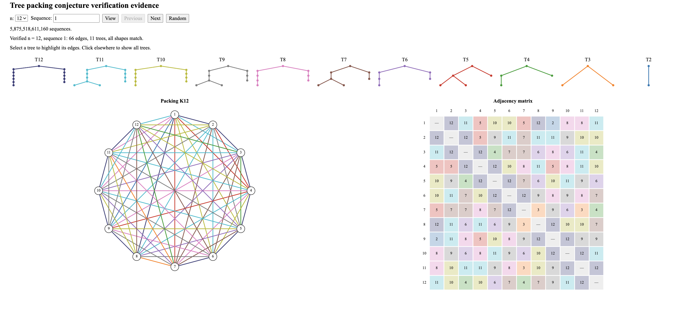
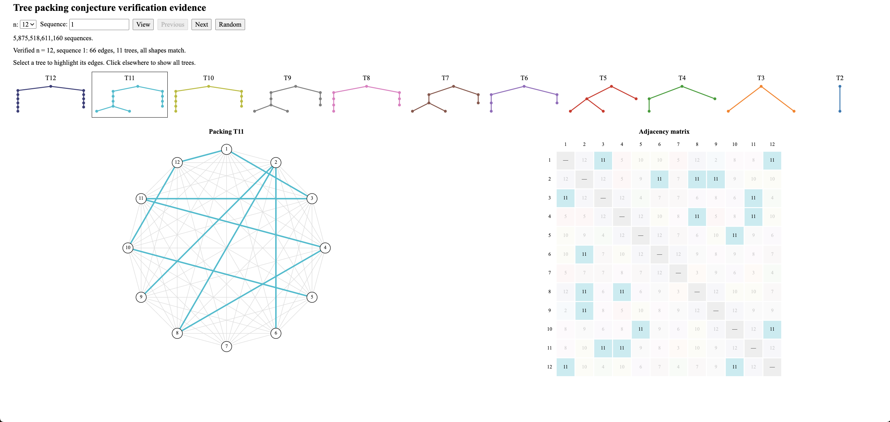

# Tree packing conjecture through n=12 code

A sequence chooses one tree shape per size from 2 through n, ignoring vertex names. For n=2 through 12, the solver packs it into $K_n$ without reusing edges. Sequences start at 0 in catalog order, with smaller trees changing fastest.

## Interactive explorer

[Tree packing explorer](https://alexyaroshe.com/tree-packing/) · [Ledger format explained](https://alexyaroshe.com/tree-packing-ledger-format/)

<a href="https://alexyaroshe.com/tree-packing/"></a>

<a href="https://alexyaroshe.com/tree-packing/"></a>

## Files

| File or folder | Contents |
|---|---|
| [trees.txt](trees.txt) | All tree shapes (2–12 vertices) |
| [solver/](solver/) | Solver |
| [checkers/](checkers/) | Two C certificate checkers |
| [certificates/](certificates/) | Retained certificate samples |
| [tests/](tests/) | Checker tests & worked example |
| [runner_and_tests/](runner_and_tests/) | Campaign, runner & tests |
| [validation_and_tools/](validation_and_tools/) | Validation, build & tools |

See the [three-vertex example](tests/examples/example.md)

## Certificates

Host vertices are numbered 0 through n−1. Edge IDs start at 0, ordered by the smaller endpoint, then the larger.

At n=12, each certificate contains 66 binary bytes: 11 for $T_{12}$, 10 for $T_{11}$, down to one for $T_2$. Each byte is an edge ID. Certificates have no headers and follow batch sequence order.

Temporary certificates go in the state's work/ directory. After both checkers accept a batch, its records and samples are saved in ledger.sqlite; working files are deleted. Compressed batch records store samples (as hexadecimal text in sample_hex). The plan keeps the first 1024 certificates from batches 0, 256, 512, …, plus the highest numbered batch.

Retained n=12 samples are in [certificates/](certificates/). Recorded ledger (Zenodo): [10.5281/zenodo.23537606](https://doi.org/10.5281/zenodo.23537606).

## Requirements

Linux, Python, NetworkX, GCC. Campaigns also need Bash, gentreeg (nauty) and kissat.

Run commands from the repository root with new output directories.

## Tests

Tests check compilation, catalogs, the example, both checkers and controller recovery using small runs.

```sh
python3 -B validation_and_tools/check_release.py --output ../portable-checks
```

## New run

The certificates take quite a bit of space, so you need about 20 GB of storage. Use a persistent session with N workers, up to the available CPU count.

```sh
python3 validation_and_tools/build.py --output ../n12-build
python3 validation_and_tools/gate_target.py --build ../n12-build --output ../n12-gate
python3 runner_and_tests/campaign.py run --build ../n12-build --gate ../n12-gate \
  --plan runner_and_tests/plan.json --state ../n12-state --workers N
python3 runner_and_tests/campaign.py audit --state ../n12-state
```

Build and gate on the computing machine; repeat both after a reboot.

A complete audit must report 1,400,833 batches and 5,875,518,611,160 cases.

The campaign audit checks coverage and both checker verdicts for new runs.
